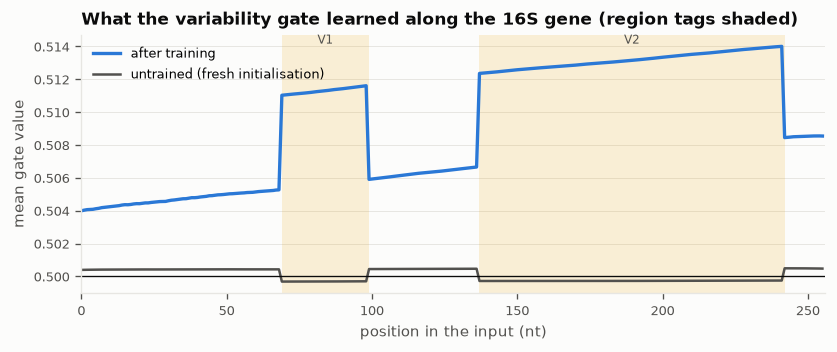

# DSNI: Recommending Bacterial Cultivation Conditions from 16S rRNA

[](LICENSE)
[](data/README.md)
[](https://www.python.org/downloads/)
[](https://pytorch.org/)
[](https://doi.org/10.5281/zenodo.24524177)

Code and data for *Recommending Bacterial Cultivation Conditions from 16S rRNA* by Juntang Wang, Hao Wu, Sheng'en Li, Yihan Wang, Dongmian Zou† and Shixin Xu†. † Corresponding authors. The manuscript is under review.

> **DSNI** (DSMZ and NIH Integrated) pairs one 16S rRNA gene sequence per bacterial strain with four cultivation conditions: growth medium, temperature, pH and oxygen requirement. Labels and taxonomy come from BacDive and MediaDive (DSMZ), sequences from NCBI. The release has 20,059 strains from 3,066 genera, a genus-disjoint train / val / test split for measuring generalisation to unseen genera, a scripted rebuild from the public sources, and four model arms from a k-mer baseline to a Transformer with a biological variability gate.

## 📰 News

- **2026-11**: The dataset is rebuilt from the public BacDive, MediaDive and NCBI interfaces by one script, with every filter counted in a manifest. The repository is restructured around it; earlier data files are superseded.

## 📌 Task and models

Given a 16S rRNA sequence, predict the media class (42 classes), temperature class (psychrophile, mesophile, thermophile), pH class (acidophile, neutrophile, alkaliphile) and oxygen requirement (aerobe, facultative, microaerophile, anaerobe). Labels are often missing, so every loss and metric masks them.

| Arm | Where | What |
|:--|:--|:--|
| `k-mer + RF` | `dsni.baselines` | 3-, 4- and 5-mer counts (1,344 features) into one random forest per task |
| `CNN Encoder` | `dsni.lit.LitCNN` | stacked 1-D convolutions, masked mean pooling |
| `Transformer (Flat)` | `dsni.lit.LitTransformer`, `gate="none"` | Transformer encoder over nucleotide tokens |
| `Transformer + Gating` | `dsni.lit.LitTransformer`, `gate="bio"` | the same encoder with a per-position gate `g = sigmoid(W [region tag, position, local GC, local entropy] + b)` on the embeddings (1,280 parameters at width 256) |

## 📦 Installation

```bash
git clone https://github.com/Q9gJYx/AI4DSNI.git
cd AI4DSNI
uv sync                      # or: pip install -e ".[demo]"
```

`uv sync` installs the development group (tests, linters, Jupyter). Rebuilding the dataset needs the `build` extra: `uv sync --extra build`.

## 🚀 Demo

Run the demo on Colab:

[](https://colab.research.google.com/github/Q9gJYx/AI4DSNI/blob/main/notebooks/demo_dsni.ipynb)

[`notebooks/demo_dsni.ipynb`](notebooks/demo_dsni.ipynb) loads the dataset (it ships with the repository), shows why the split is made by genus, compares `Transformer (Flat)` with `Transformer + Gating` at the same small budget, and shows what the gate learns along the 16S gene. It evaluates the two small trained models shipped in `checkpoints/`, so it takes about a minute on a Colab CPU and shows the same numbers on every machine; `TRAIN = True` retrains them instead (about 5 minutes on a GPU).

Test split of the full table (3,009 strains from 461 genera unseen in training); the models are 2-layer Transformers at width 64, trained on a quarter of the training strains:

| Model | Joint acc. | Media acc. | Media top-3 |
|:--|--:|--:|--:|
| majority class | 0.043 | 0.228 | 0.439 |
| `Transformer (Flat)` | 0.118 | 0.281 | 0.490 |
| `Transformer + Gating` | 0.130 | 0.288 | 0.505 |



The trained gate opens further at the positions tagged hypervariable (fixed E. coli coordinates, so approximate) than at the conserved ones, in every run we trained. The accuracy gap is a demo, not evidence: the shipped run was selected, and two retrains of the same recipe gave a tie and a small lead for the flat model. The notebook says how the setting was chosen, and the paper's claims rest on the full-scale protocol below.

## 📊 Dataset

| | |
|:--|:--|
| Strains / genera / species | 20,059 / 3,066 / 15,272 |
| Split (train / val / test) | 14,041 / 3,009 / 3,009 strains; 2,146 / 459 / 461 genera; no genus in two splits |
| Sequence | one 16S rRNA gene per strain, 500 to 1,600 nt, median 1,468 |
| Labelled share | temperature 99.7%, pH 73.4%, media 70.7%, oxygen 53.1%, all four 35.2% |
| Media | 1,169 distinct primary media; the 41 most frequent are classes, the rest `Other` |
| Sources | BacDive release 2026-06-01, MediaDive, NCBI nuccore; built 2026-11-24 |

Two ways to get it:

```python
from dsni import data

table = data.load()  # the full table, shipped in data/dsni.parquet
sample = data.load(data.SAMPLE)  # 5,079 strains, whole genera, for quick experiments
```

```bash
uv run --extra build python scripts/build_dsni.py   # rebuild from the public sources, about 15 minutes
```

Both tables ship with the repository, so a clone or a Colab session has the full dataset without a download step; `data/manifest.json` lists their checksums. Release v1.0.0 is archived on Zenodo ([10.5281/zenodo.24524178](https://doi.org/10.5281/zenodo.24524178)), and `dsni.data.fetch()` downloads its table for installs without the repository. The data card is [`data/README.md`](data/README.md), the schema and label rules are in [`docs/dataset.md`](docs/dataset.md).

## 🔁 Running the paper's protocol

```bash
uv run python scripts/reproduce_paper.py --version_dir out/v1   # out/v1/<arm>/s<seed>/result.pt, then a leaderboard
```

The protocol is one table, [`dsni.protocol`](src/dsni/protocol.py): 22 arms over five seeds, covering the four arms of the main table, the gate ablations, the few-shot fractions, the random-split leakage comparison and the 440-token crop. **Nothing in this repository has been run at that scale**; `scripts/smoke_test.py` runs that same table at toy size, so every run is known to start and finish. Runs are skipped when their result exists, so a campaign can be stopped and resumed. The rows of the paper's tables that have no code here (RNABERT with and without gating, GROWREC, k-NN, k-mer + XGBoost) are listed in [`ROADMAP.md`](ROADMAP.md).

One run by hand:

```bash
uv run python scripts/train.py --model LitTransformer --model.gate bio --run_dir out/v1/transformer_gated/s0
uv run python scripts/run_baseline.py --run_dir out/v1/kmer_rf/s0
```

## 🧩 Repository structure

```
AI4DSNI/
├── src/dsni/
│   ├── schema.py       # columns, label vocabularies, thresholds
│   ├── build.py        # BacDive / MediaDive / NCBI -> the DSNI table
│   ├── splits.py       # genus-disjoint stratified split
│   ├── data.py         # load, fetch, tokenise, LightningDataModule
│   ├── features.py     # region tags, local GC, local entropy
│   ├── models.py       # CNN and Transformer encoders, variability gate, multi-task head
│   ├── lit.py          # LightningModules and the LightningCLI entry point
│   ├── baselines.py    # k-mer + RF
│   ├── metrics.py      # metrics, result files, aggregation, bootstrap
│   ├── protocol.py     # the paper's experiments as a table of runs
│   └── plots.py        # figures of the notebooks
├── scripts/            # build_dsni.py, train.py, run_baseline.py, reproduce_paper.py, smoke_test.py
├── notebooks/          # demo_dsni.ipynb
├── checkpoints/        # the two small trained models the demo evaluates
├── tests/              # pytest, one file per module
├── data/               # the release (full table, sample, media map, recipes, manifest) and its data card
├── docs/               # dataset.md, dependencies.md
└── images/             # figures written by the notebooks
```

## 🛠 Development

```bash
uv run pytest                                   # 81 tests, offline, about 30 seconds
uv run ruff check . && uv run mypy              # lint and types
uv run python scripts/smoke_test.py             # the parser, the sample and the paper's 22 arms at toy size
uv run python scripts/smoke_test.py --notebooks # also execute the demo notebook
```

## 🔗 Dependencies and attribution

The dataset is derived from [BacDive](https://bacdive.dsmz.de) and [MediaDive](https://mediadive.dsmz.de) (Leibniz Institute DSMZ) and from sequence records in NCBI nuccore. Please cite them when you use DSNI; the references, licences and what each source contributes are in [`docs/dependencies.md`](docs/dependencies.md).

## 📚 Citation

```bibtex
@unpublished{wang2026dsni,
  title  = {Recommending Bacterial Cultivation Conditions from 16S rRNA},
  author = {Wang, Juntang and Wu, Hao and Li, Sheng'en and Wang, Yihan and Zou, Dongmian and Xu, Shixin},
  year   = {2026},
  note   = {Manuscript under review}
}
```

To cite the dataset and code release itself:

```bibtex
@software{wang2026dsni_release,
  title     = {DSNI: Recommending Bacterial Cultivation Conditions from 16S rRNA},
  author    = {Wang, Juntang and Wu, Hao and Li, Sheng'en and Wang, Yihan and Zou, Dongmian and Xu, Shixin},
  year      = {2026},
  version   = {1.0.0},
  publisher = {Zenodo},
  doi       = {10.5281/zenodo.24524177}
}
```

`CITATION.cff` carries the same metadata for the "Cite this repository" button. The DOI above always resolves to the latest release; v1.0.0 itself is [10.5281/zenodo.24524178](https://doi.org/10.5281/zenodo.24524178).

## 📝 License

Code: MIT, see [LICENSE](LICENSE). Data: CC BY 4.0, with attribution to the upstream sources as described in [`data/README.md`](data/README.md).
