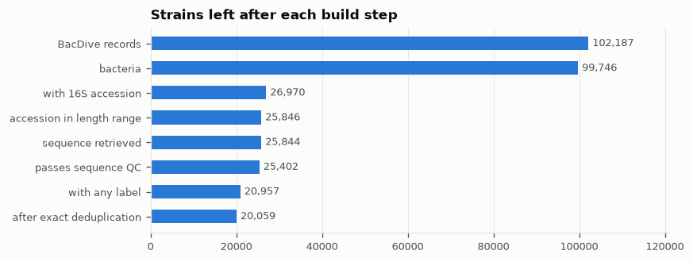
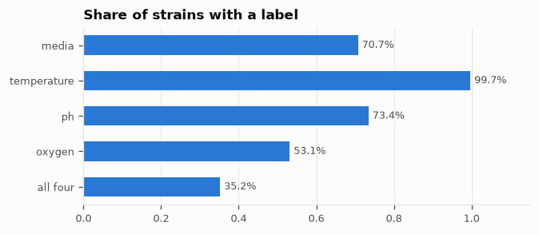
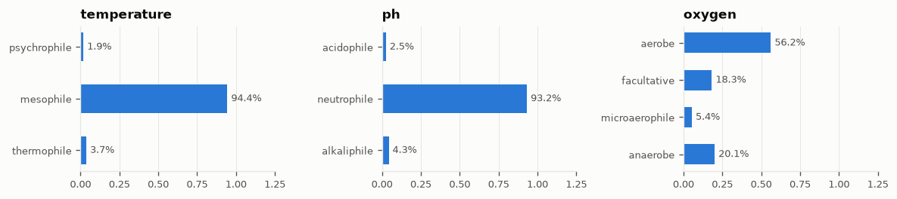
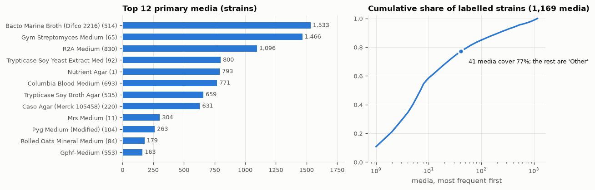
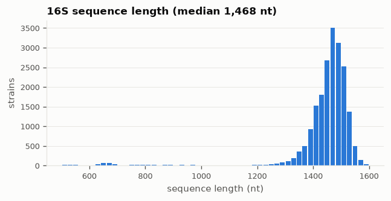
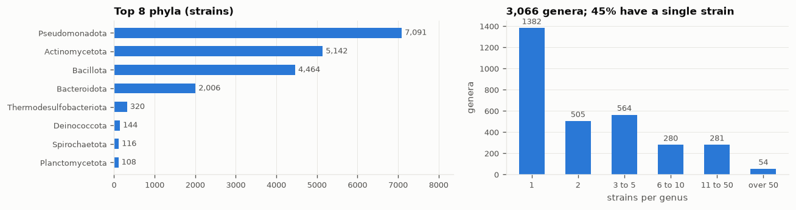
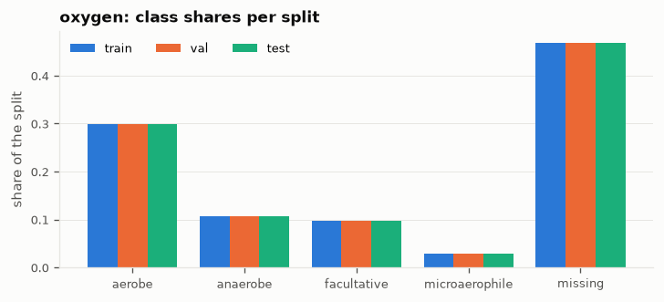
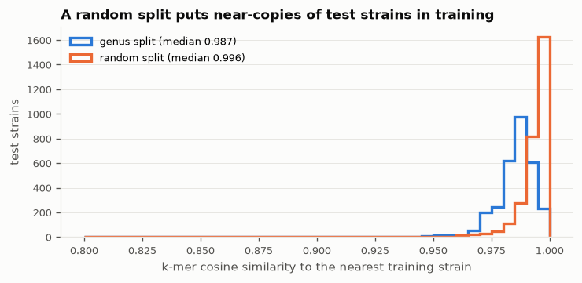
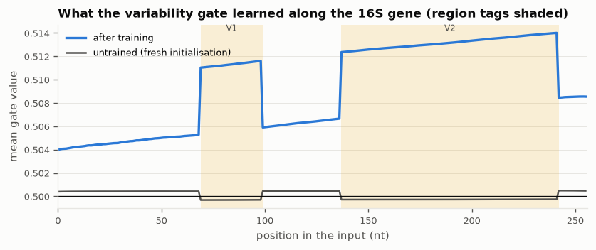

# The DSNI table

One row per bacterial strain. This page documents the columns, the rules that turn BacDive
records into labels, and the split. The numbers refer to the release built on 2026-11-24
(20,059 strains); `notebooks/demo_dsni.ipynb` regenerates every figure shown here.

## Columns

| Column | Type | Missing | Meaning |
|:--|:--|--:|:--|
| `strain_id` | string | 0.0% | Row key, `BacDive:<id>`. |
| `bacdive_id` | int | 0.0% | BacDive strain identifier. |
| `dsm_number` | int, nullable | 27.5% | DSMZ catalogue number, when the strain is held by DSMZ. |
| `type_strain` | bool | 0.0% | True if BacDive marks the strain as the type strain of its species. |
| `phylum` | string | 0.0% | Phylum (LPSN name when available). |
| `class` | string | 0.0% | Class. |
| `order` | string | 0.0% | Order. |
| `family` | string | 0.0% | Family. |
| `genus` | string | 0.0% | Genus; the grouping unit of the splits. |
| `species` | string | 0.0% | Species binomial. |
| `accession` | string | 0.0% | INSDC accession, with version, of the 16S rRNA sequence used for this strain. |
| `accessions_all` | list of string | 0.0% | Every 16S accession BacDive lists for the strain. |
| `sequence` | string | 0.0% | 16S rRNA gene sequence over A, C, G, T; any other base is N. |
| `seq_len` | int | 0.0% | Sequence length in nucleotides. |
| `temp_c` | float | 0.3% | Cultivation temperature in Celsius: median of optimum, else of growth, entries. |
| `temperature` | categorical | 0.3% | psychrophile (< 20), mesophile (20 to 45) or thermophile (> 45). |
| `ph_value` | float | 72.1% | Strain-level cultivation pH from BacDive, same precedence as temperature. |
| `medium_ph` | float | 37.5% | pH of the primary medium from MediaDive (mean of its pH range). |
| `ph_source` | string | 26.6% | `strain` if `ph` comes from `ph_value`, `medium` if from `medium_ph`. |
| `ph` | categorical | 26.6% | acidophile (< 6), neutrophile (6 to 8) or alkaliphile (> 8). |
| `oxygen` | categorical | 46.9% | aerobe, facultative, microaerophile or anaerobe. |
| `media_id` | string | 29.3% | MediaDive id of the primary medium (first DSMZ-linked medium with growth). |
| `media_all` | list of string | 0.0% | MediaDive ids of every medium on which the strain grows. |
| `media` | categorical | 29.3% | Media class: one of the most frequent media ids, or `Other`. |
| `split` | string | 0.0% | train, val or test; genera never cross splits. |

Class columns are pandas categoricals whose categories are the full class list, so
`table[task].cat.codes` is the label encoding (`-1`, mapped to `-100`, where the label is
missing). `table.attrs["manifest"]` and `table.attrs["media_names"]` carry the build manifest
and the MediaDive id to name map.

## From records to strains

A strain is kept when it is a bacterium, BacDive lists a 16S accession of 500 to 1,600 nt for
it, NCBI returns that sequence with under 1% ambiguous bases, and it has at least one of the
four labels. Strains with exactly the same sequence collapse to the record with the most
labels (DSMZ records win ties). `accession` records the version NCBI returned, so the exact
sequence can be retrieved again. Code: `dsni.build.parse_record`, `dsni.build.assemble`.

## Label rules

**Temperature and pH.** BacDive lists entries of type `optimum`, `growth`, `minimum` and
`maximum`, each a value or a range. The representative value is the median of the positive
`optimum` entries if there are any, otherwise of the positive `growth` entries; a range counts
as its midpoint. Classes: psychrophile below 20 C, mesophile 20 to 45 C, thermophile above
45 C; acidophile below pH 6, neutrophile pH 6 to 8, alkaliphile above pH 8. Both bounds
belong to the middle class.

**pH is mostly a cultivation condition, not a measured trait.** Strain-level pH exists for a
minority of strains. When it is missing, the pH of the strain's primary medium (mean of the
MediaDive pH range) is used and `ph_source` is `medium`; this is the case for 62% of
the pH-labelled strains. For those rows the class says at which pH the strain is grown, which
is a proxy for, not a measurement of, its pH optimum, and it is partly a function of the
medium label. Filter on `ph_source == "strain"` for the measured values, or pass
`--ph_fallback false` to the build to leave the others unlabelled.

**Oxygen.** BacDive's vocabulary maps to four classes: aerobe (aerobe, obligate aerobe),
anaerobe (anaerobe, obligate anaerobe), facultative (facultative anaerobe, facultative
aerobe), microaerophile. Any facultative report gives `facultative`. A strain with reports of
both aerobic and anaerobic growth and no facultative report is left without an oxygen label,
because the reports contradict each other. Otherwise the most frequent class wins.

**Media.** The primary medium is the first medium in the BacDive record that links to
MediaDive and has recorded growth; `media_all` keeps every such medium. The 41 most
frequent primary media are classes of their own (77% of the labelled strains) and the
remaining 1,128 media are pooled as `Other`, giving 42 classes. A strain
often grows on several media, so the primary medium is one valid answer among those in
`media_all`, not the only one.

## Sequences and taxonomy

Sequences are upper-case over A, C, G, T; U is written as T and every other symbol as N.
Taxonomy uses LPSN names where BacDive provides them.

## Split

Genera are assigned to train, val or test whole, largest first, each to the split where it
most reduces a chi-square deviation from the 70 / 15 / 15 targets, computed over the number of
strains and over every label class including "missing". The procedure is deterministic and
has no seed. Code: `dsni.splits.greedy_stratified_split`.

| Split | Strains | Genera |
|:--|--:|--:|
| train | 14,041 | 2,146 |
| val | 3,009 | 459 |
| test | 3,009 | 461 |

Under a random row-level split, 91% of the test strains would have their genus in training
and 14.3% would have a near-identical training sequence (k-mer cosine of 0.999 or
more). The genus-disjoint split brings that to 0.5%. It does not bring it to zero:
closely related genera, and strains recorded under an older genus name, can still carry
almost the same 16S gene.

## The variability gate

Mean gate value along the first 256 nt of the input, from the gated demo model in `checkpoints/`
(written by `notebooks/demo_dsni.ipynb`). An untrained gate is near 0.5 everywhere; after training
it is higher inside the positions tagged hypervariable than between them. The tags are fixed
E. coli coordinates applied to unaligned sequences, so they mark the hypervariable regions only
approximately, especially for partial sequences. This is a demo-scale model, not a result of
the paper.

